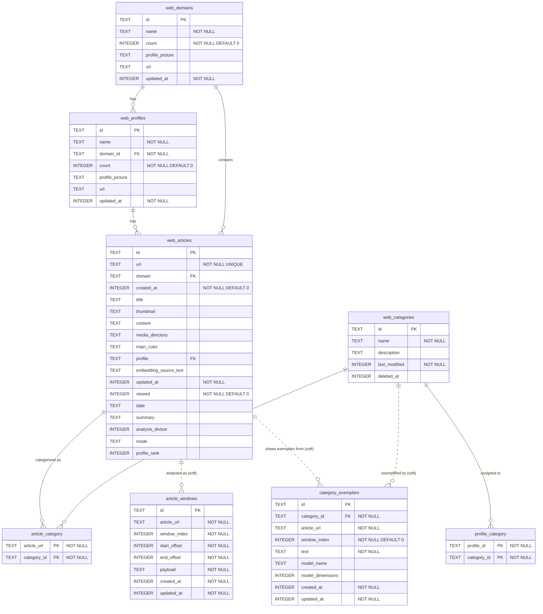

# Database ER Diagram

Source: `src-tauri/src/web_store.rs`

## Relationships Summary

| From           | To                 | Type | FK                                                                |
| -------------- | ------------------ | ---- | ----------------------------------------------------------------- |
| web_domains    | web_profiles       | 1:N  | `web_profiles.domain_id` -> `web_domains.id`                      |
| web_domains    | web_articles       | 1:N  | `web_articles.domain` -> `web_domains.id`                         |
| web_profiles   | web_articles       | 1:N  | `web_articles.profile` matches `web_profiles.id` (soft)           |
| web_categories | article_category   | 1:N  | `article_category.category_id` -> `web_categories.id`             |
| web_articles   | article_category   | 1:N  | `article_category.article_url` -> `web_articles.url` (soft)       |
| web_categories | profile_category   | 1:N  | `profile_category.category_id` -> `web_categories.id` (formal FK) |
| web_domains    | profile_category   | 1:N  | `profile_category.profile_id` matches `web_domains.id` (soft)     |
| web_profiles   | profile_category   | 1:N  | `profile_category.profile_id` matches `web_profiles.id` (soft)    |
| web_categories | category_exemplars | 1:N  | `category_exemplars.category_id` -> `web_categories.id` (soft)    |
| web_articles   | category_exemplars | 1:N  | `category_exemplars.article_url` -> `web_articles.url` (soft)     |
| web_articles   | article_windows    | 1:N  | `article_windows.article_url` -> `web_articles.url` (soft)        |

> **Notes:**
>
> - `web_articles.profile` is a soft foreign key (string match, no FK constraint).
> - `profile_category.profile_id` is a soft key shared by domains and channels:
>   stored lowercase, matched case-insensitively. It is the filter source for
>   the dashboard's category facet (stored links only, never derived from the
>   entity's articles).
> - `article_category.article_url` and the `*_url` columns of
>   `category_exemplars`/`article_windows` reference `web_articles.url` by
>   convention (no formal FK constraint); `article_category` and
>   `profile_category` do carry a formal FK to `web_categories.id`.
